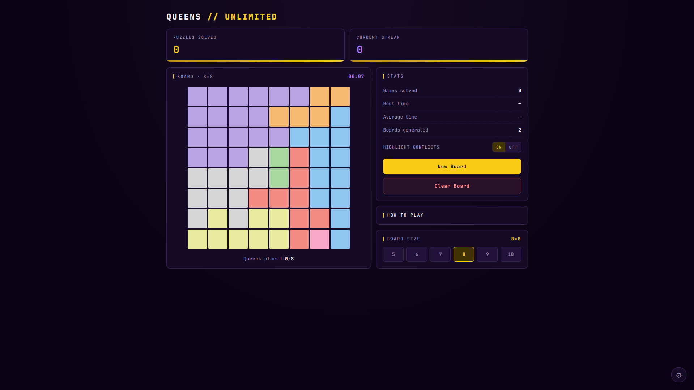

# Queens Unlimited

Place queens on a color-coded grid so that no two of them attack each other — with unlimited boards.

**Live site:** https://queens-unlimited.vercel.app

## How to Play

- Place exactly one queen in each row, each column and each colored region
- Queens cannot touch each other, not even diagonally
- Click once to mark an ×, twice to place a queen, a third time to clear
- Click and drag to paint several cells at once

## Features

- Board sizes from 5x5 to 10x10 with unlimited generated boards
- Optional conflict highlighting, plus new board and clear board actions
- Timer with solve count, best time, average time and streaks
- Dark and light themes, high contrast and color-blind modes
- Sound effects with volume control

## Tech Stack

- [Vite](https://vite.dev/)
- React
- TypeScript
- Hosted on [Vercel](https://vercel.com)
